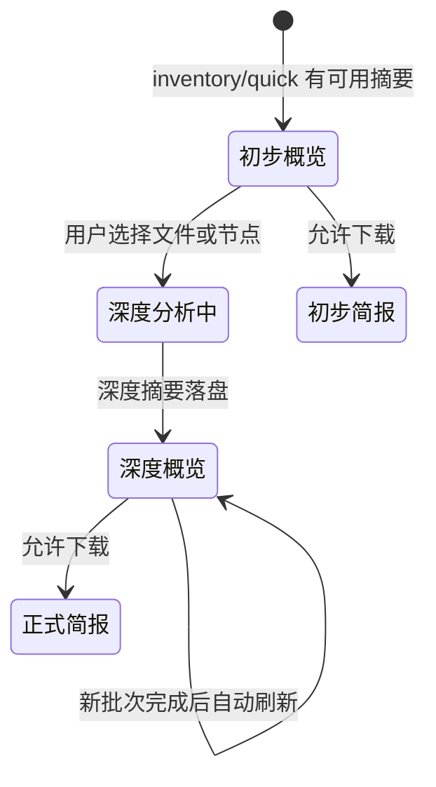

# SJFX 数据分析 Agent：完整系统说明与快速部署

SJFX 是一个本地运行、多用户隔离、证据可回溯、任务可恢复的数据分析系统。它把目录扫描、多格式文件解析、摘要、智能目录、情报概览、邮件关系挖掘、翻译、结构化分析、交互式对话和报告导出组织成一个完整工作流。

本文同时作为 README 和新成员培训文档，目标是让读者能够：

- 理解系统目前已经实现的模块和模块之间的关系。
- 在一台 Linux 服务器或本地电脑上快速启动系统。
- 理解多用户隔离是怎么实现的，以及为什么安全边界收敛在一个函数里。
- 知道一次普通导入和一次大数据包处理会发生什么。
- 知道邮件关系挖掘目前能做到什么，几千份邮件应该怎样运行。
- 知道哪些结果可以作为证据，哪些只是待复核线索。
- 知道代码从哪里读、出问题时从哪一层排查。

## 一、系统能解决什么问题

传统做法通常是把全部资料一次性交给大模型，然后得到一段无法复核的文字。这样会遇到四个问题：文件太多导致上下文不足；一个文件失败拖垮整批；处理中断后无法继续；结论无法回到原文。

SJFX 的做法是把分析拆成可持久化的阶段和小任务：

```text
原始目录
  → 全量清单和文件指纹
  → 用户选择范围
  → 文件解析和证据索引
  → 文件摘要 / 节点摘要
  → 智能目录 / 情报概览
  → 关系挖掘 / 交互式检索
  → 研究方向和正式报告
```

每个长任务都有状态、心跳、尝试次数和检查点。用户可以暂停、继续、结束本次运行、切换数据包、补充剩余文件，已经完成的结果不会被清空。多个用户共用同一套实例，但彼此的数据在接口层和磁盘层都是隔离的。

## 二、功能模块总览

| 模块 | 当前已实现 | 适合解决的问题 | 主要入口 |
| --- | --- | --- | --- |
| 多用户与访问控制 | 注册、登录、改密、会话、按 owner 隔离、管理员切视角 | 多人共用一套系统而互不可见 | `sjfx_multiuser/` |
| 文件上传入口 | 网页分片上传、断点续传、按会话落盘到自己的目录 | 让用户不必接触服务器路径和账号 | `sjfx_multiuser/upload_routes.py` |
| 交互式对话 | 基于当前数据包、摘要和证据问答；支持检索、实体、主题和时间范围 | “这个结论来自哪里？”、“某人涉及哪些事项？” | `services/conversation.py`、`services/turn_runtime.py` |
| 文件导入与解析 | 目录扫描、多格式解析、压缩包成员、哈希和检查点 | 把散落资料变成可检索的统一文档 | `services/unified_parser.py`、`package_analysis.py` |
| 智能目录 | 原始目录、逻辑目录、主题/实体/事项节点和版本 | 看清数据包结构和资料之间的组织关系 | `services/folder_analysis.py`、`package_overview.py` |
| 摘要生成 | 文件初步摘要、深度摘要、节点摘要、跨文件概览 | 先快速浏览，再深挖重点 | `app.py`、`services/reporting.py` |
| 大数据包 | inventory、quick、deep、summary、report 隔离队列 | 数百到数千文件的可恢复分阶段处理 | `large_package_worker.py` |
| 邮件关系挖掘 | 回复链、引用链、事项链、通信流、共享实体 | 深挖邮件联系和事项网络 | `services/mail/` |
| 邮件研究台 | 自然语言检索、字段抽取、结果集收敛、证据导出 | 从几千封邮件里定位事实并保留出处 | `static/mail-research.js`、`services/mail/research/` |
| 翻译 | 本地翻译、翻译记忆、导入阶段工作译文和质量复核 | 让跨语言资料进入同一分析流程 | `services/translation.py`、`offline_translation.py` |
| 证据校验 | 原文定位、引用、哈希、支持状态和置信度 | 防止模型猜测成为正式结论 | `services/evidence.py`、`claim_verifier.py` |
| 结构化分析 | CSV/XLSX/JSON 字段、缺失、重复、异常和汇总 | 处理表格和清单型资料 | `services/structured_profile.py`、`homogeneous_documents.py` |
| 报告导出 | JSON、Word、ZIP 证据包 | 交付机器结果和人工报告 | `services/exporter.py`、`reporting.py` |
| 任务控制 | 暂停、继续、重试、补充、切换、前台优先 | 保证系统长时间运行且可控 | `worker.py`、`storage.py` |

下面按模块解释“现在做到什么”和“预期还能做到什么”。

## 三、多用户隔离与访问控制

这一层是整个系统最近一次大改造的结果，也是改动风险最集中的地方，因此单独成章。

### 3.1 账号体系

| 能力 | 实现 |
| --- | --- |
| 注册 | `POST /register`，用户名/密码强度校验，按来源 IP 做注册频率限制 |
| 登录 | `POST /login`，成功后下发会话 cookie `sjfx_session` |
| 登出 | `GET/POST /logout`、`POST /api/auth/logout`，会话立即作废 |
| 当前身份 | `GET /api/auth/me` |
| 自主改密 | `POST /api/auth/change-password` |
| 强制改密 | 管理员重置密码后置 `must_change_pw`，服务端强制跳转改密页（不是仅前端拦截） |
| 密码存储 | `werkzeug.security` 的 scrypt（参数 `32768:8:1`），零新增依赖 |
| 会话 | 服务端会话表 + 有效期 + 机器指纹 + 可被管理员批量吊销 |

角色只有两种：`admin` 和 `user`。第一个管理员由 `UserStore.bootstrap_first_admin()` 在初始化时创建，`owner_id` 固定为 `primary`。

页面：`/login`、`/register`、`/change-password`、`/admin`；用户栏脚本由 `/auth-static/userbar.js` 提供。

### 3.2 归属隔离模型：一个纯函数

`app.py` 里有 60 处调用 `_request_owner_id()`。把这 60 处同时改对，靠的不是耐心，而是把决策收敛进一个纯函数：

```python
# sjfx_multiuser/ownership.py
resolve_owner(session, viewing_owner, config_owner_id) -> OwnerDecision
```

它不依赖 request 对象，因此可以脱离框架直接测试。三条铁律（改代码前必读）：

1. **绝不从客户端输入取 owner。**`?as_owner=`、请求头、cookie 里的 owner 一律不可信，只从服务端会话派生。`OwnerDecision.source` 会记录来源是 `session`、`view_as` 还是 `config_fallback`，便于排查“为什么看到了/看不到”。
2. **`None` 表示“不过滤”，也就是能看全部。**这是 `services/storage.py` 的既有约定（`scan_owned` 里 `not owner_id or ...`）。因此**任何意外返回 `None` 都等于越权**，这是本模块最危险的失败模式，每个分支都有对应测试。
3. **无会话时回落到配置值，而不是 `None`。**回落成 `None` 会让所有脚本和后台任务变成“看全部”；回落到 `Config.OWNER_ID`（`SJFX_OWNER_ID`，默认 `primary`）与改造前行为一致，零回归。

### 3.3 磁盘隔离

导出产物按归属分目录存放：`outputs/<owner>/…`，旧的平铺链接通过 `outputs/legacy/` 兼容。上传暂存区同样按归属分层：`outputs/_uploads/<owner>/…`。

### 3.4 管理员与切视角

管理员默认拥有全局视角，也可以“切成某个用户”来复现对方看到的内容：

| 接口 | 作用 |
| --- | --- |
| `GET /api/admin/users` | 用户列表 |
| `POST /api/admin/users` | 建用户 |
| `POST /api/admin/users/<user_id>/password` | 重置密码（可要求强制改密） |
| `DELETE /api/admin/users/<user_id>` | 停用/删除用户 |
| `GET/POST /api/admin/view-as` | 查看或切换当前视角 |

切视角是**服务端会话状态**，不是客户端参数——这正是 3.2 铁律 1 要防的东西。

### 3.5 路由归属审计闸门

`sjfx_multiuser/route_audit.py` 把“每个带 id 的接口都要校验归属”从人工纪律变成自动检查：

```bash
python sjfx_multiuser/route_audit.py            # 默认检查 app.py
python sjfx_multiuser/route_audit.py 路径/app.py
```

它分两层：

1. **模式层**：扫描每个处理函数，看有没有归属过滤写法（`_request_owner_id()`、`_effective_owner()`、`scan_owned()`、`require_scan()`、`_require_admin()`、`_large_package_owned()`、`owner_id=` 传参）。
2. **清单层**：模式没命中的必须出现在 `KNOWN_SAFE_DELEGATORS` 里，**且必须写明原因**。

之所以不做成“启动即失败”，是因为实测有 11 条带 id 路由的文本里不含归属写法但实际安全（例如 9 条大包路由走 `_large_package_owned()`，另有 2 条是纯转发，校验在被调函数内部）。把误报做成启动条件，只会逼人把闸门关掉。**误报比不检查更糟**——所以用“证据 + 显式清单”。

当前闸门的实测结果（2026-09-22，对这个 app.py）：

```text
待审对象: app.py
  总路由数: 97
  带 id 路由: 75
  模式命中且已处理: 70
  清单层已校验（纯转发等）: 5
  未处理: 0
  结论: PASS
```

### 3.6 认证相关的安全默认值

`config.py` 在启动时强制下列约束，不满足直接拒绝启动：

- 绑定非回环地址时，`AUTH_REQUIRED` 必须为真（`AUTH_REQUIRED` 在回环地址上默认 `0`，其他情况默认 `1`）。
- `AUTH_REQUIRED=1` 时必须配置 `SJFX_API_ACCESS_TOKEN`，否则报错退出。
- 启用认证时自动关闭交互式 API 文档。
- 模型地址默认只允许 `127.0.0.1`、`localhost`、`::1`，资料不会被意外发往公网。

请求鉴权分三条路：

| 路径 | 鉴权方式 |
| --- | --- |
| `/api/auth/*`、`/api/admin/*` | 会话 cookie；`/api/admin/*` 额外要求 admin 角色 |
| `/api/uploads/*`、`/upload` | 会话 cookie（见第四章） |
| `/outputs/...?ticket=…` | 一次性下载票据，校验后立即作废 |
| 其余 `/api/*` | `X-SJFX-Token` 或 `Authorization: Bearer <SJFX_API_ACCESS_TOKEN>` |

已知边界：`document_translations` 表按设计**没有 `owner_id` 列**，`storage.list_translation_page()` 只按 `scan_id` 查询。因此 `/api/translations/<scan_id>` 的归属校验必须在路由层补：当前实现在鉴权中间件里对该路径单独校验 `scan_owned()`，不属于当前用户时统一返回 404（而不是 403，避免泄露“这个 id 存在”）。这是“表结构没带归属”的接口的通用处理方式，新增同类接口时请照此办理。

## 四、分片上传入口

上传解决的是“用户不需要碰服务器账号和路径”，它与扫描、分析、审计是并行的两条线：文件用 scp 传进来还是网页传进来，系统内的处理链路完全一样。

| 接口 | 说明 |
| --- | --- |
| `GET /upload` | 上传页面 |
| `POST /api/uploads` | 开始一次上传会话（声明文件清单） |
| `GET /api/uploads/<session_id>` | 查询进度，用于断点续传 |
| `PUT/POST /api/uploads/<session_id>/chunks/<int:file_index>` | 上传单个分片 |
| `POST /api/uploads/<session_id>/finalize` | 合并分片并落盘 |
| `DELETE /api/uploads/<session_id>` | 中止并清理 |

行为约定：

- 落盘根目录为 `outputs/_uploads/<owner>/`，目标必须落在 `SCAN_ALLOWED_ROOTS` 之内，否则拒绝。
- **单个分片必须 ≤ 4 MB**：`app.py` 的 `max_content_length` 是 `4 * 1024 * 1024`，超过会被框架直接拒绝。
- 鉴权走会话 cookie，未登录一律 401；不允许用全局 token 代替，因为浏览器无法安全携带它。
- 上传完成后产物就是普通的待扫描目录，后续走标准扫描流程。

## 五、交互式对话

### 当前实现

交互式对话不是通用聊天机器人，而是绑定当前数据包的检索和分析入口。系统会先根据用户问题确定范围，再从证据索引、文件摘要、节点摘要、关系图和已生成的概览中检索上下文。

当前可以进行：

- 按关键词、文件、目录、主题、实体、事项和时间范围检索。
- 询问某条结论的来源，并返回文件、页码、段落或证据编号。
- 询问某个人、机构、邮箱或事项涉及的文件集合。
- 对已经生成的摘要做跨文件比较和归纳。
- 在不改变原始证据的前提下生成研究方向候选。
- 保留对话轮次、上下文和失败/取消状态。

### 处理边界

对话可以解释已经落盘的证据和摘要，但不能凭空证明资料中不存在的事实。没有足够证据时，系统应返回“证据不足”或“需要补充文件”，而不是用模型常识填空。

### 预期增强

下一步可以加入对话中直接创建分析范围、保存查询视图、引用多条证据、标记待核查事项、把对话结论转成审计任务，以及对实体关系图进行自然语言切片。

## 六、文件导入与解析

### 导入范围

系统支持 PDF、DOCX、PPTX、XLSX、CSV、JSON、TXT、Markdown、HTML、图片和 ZIP/TAR 等压缩包。解析器根据格式提取文本、表格、标题、页码、段落、图片、附件和元数据；压缩包成员使用逻辑路径保存。

### 解析结果

每个逻辑文件会保留：

- 相对路径、显示名称、文件类型和大小。
- 源文件 SHA-256 和解析版本。
- 完整文本或受限制的文本片段。
- 页码、段落、表格、字符范围等定位信息。
- 解析错误、部分完成和重试状态。
- 文件摘要、实体、主题和证据索引。

原文件不会被改写。解析临时文件、数据库和缓存应放在本地磁盘，避免 NAS/NFS 锁和性能问题。

### 普通导入流程

```text
扫描目录
  → waiting_for_selection
  → 用户选择文件
  → parsing_selected
  → parsed_overview
  → preliminary_summarizing
  → preliminary_nodes
  → preliminary_overview
  → deep_summarizing_files
  → deep_summarizing_nodes
  → deep_update_available
  → deep_overview_updating
  → completed / partial
```

普通导入适合用户逐步判断：先选 20 个文件生成初步摘要，完成后从“待补充文件”中再选剩余 10 个。补充只追加新范围，已完成的摘要和证据保留。

## 七、智能目录与情报概览

系统同时维护两种目录：

1. **原始目录**：真实文件、目录、压缩包和成员的完整结构。
2. **智能目录**：按主题、实体、事项、文件类型和关系重新组织的逻辑结构。

智能目录的节点不是简单文件夹，而是带有摘要、代表性文件、关键证据、成员数量和版本的分析节点。目录生成过程中会去重、合并相似主题、保留来源路径，并标记需要人工确认的边界。

情报概览会综合：

- 当前范围内的文件和节点摘要。
- 已验证和候选关系。
- 重要实体和事项统计。
- 证据覆盖率、失败项和未完成项。
- 可继续研究的问题和建议的下一批文件。

正式概览只使用允许阶段中已经完成的结果，不把后台尚未完成的深度摘要当作正式结论。

## 八、摘要生成

### 两级摘要

| 阶段 | 作用 | 可信边界 |
| --- | --- | --- |
| 初步摘要 | 快速了解文件主题、参与者、事项和待核查点 | 用于筛选和导航，不能代替完整深度核验 |
| 深度摘要 | 读取更完整内容，补充细节、证据和跨文件联系 | 可进入正式概览，但仍必须保留原文证据 |

文件摘要之后会生成节点摘要，再生成跨文件情报概览。摘要任务按批次执行，避免一次请求超过模型上下文。模型输出使用结构化字段，便于后续检索、比较和导出。

### 模型的职责

模型负责语言归纳、主题解释、摘要和研究方向候选；扫描、解析、哈希、字段抽取、去重、证据定位和关系强证据匹配由确定性代码完成。这样模型不可用时，系统仍然可以生成目录、字段、证据和基础关系。

## 九、大数据包处理

### 为什么独立

大数据包可能包含数百到数千个文件。若和普通导入共用一个队列，长任务会阻塞用户的新操作。因此大包使用独立任务表、文件队列和 Worker。

### 阶段

```text
inventory
  → quick parse
  → 用户按文件名/目录/类型选择深度范围
  → deep parse
  → 文件摘要和节点摘要
  → 情报概览
  → JSON / DOCX / ZIP
```

页面显示完整相对路径、类型、大小、快速状态、深度状态和摘要片段。用户可以只看待补充文件，也可以查看全部文件。

### 大包的实际上限

系统对单个内容对象设置统一的 10 GiB 安全上限；默认一次大包深度批次最多 500 个文件，重型文件会自动降低批次大小。扫描、目录、压缩包成员、结构化记录和报告也有独立边界。达到边界时系统会标记清单不完整或范围受限，而不是静默丢弃文件。

大包的目标是“可持续”，不是承诺任何硬件都能在短时间内深度理解几千个文件。吞吐取决于磁盘、解析耗时、模型吞吐、显存和文件格式。

## 十、大数据包问答的可复核流程

大数据包问答必须满足以下顺序，任何一步失败都要在回答中披露，而不是静默降级：

```text
当前大包与会话
  → 问题范围解析
  → 大包摘要/目录/文件索引强检索
  → 去除空摘要、失败摘要、纯元数据
  → 相关片段按文件聚合和限量
  → vLLM/Qwen 根据“问题 + 检索内容”生成答案
  → 记录实际引用文件与证据
  → 页面按实际证据数量渲染
```

“强检索”表示允许同义词、主题、实体和摘要信号参与召回，目标是找到足够相关的文件，不要求字面完全匹配；它不表示把整个大包无差别发送给模型。上下文仍受批量、字符数和 token 限制，以保证稳定性。

回答下方的证据条数是动态集合：有多少实际参与回答的文件就显示多少；检索结果少时不会用无关文件凑数，检索结果多时也不会被旧的 16 条展示上限截断。文件列表中的“范围文件”是任务范围统计，不能直接当成回答引用。

## 十一、大数据包情报概览的两个阶段



初步概览至少包含资料范围、可用摘要数、主题/目录信号、初步研究方向和限制说明。深度概览在相同数据包 ID 下更新版本号，引用新的摘要和证据统计。前端使用轮询和缓存失效机制获取新版本，用户无需重新创建任务。

## 十二、邮件关系挖掘

邮件关系是系统中的一个模块，建立在统一解析、证据索引和任务队列之上。

### 12.1 抽取的字段

对 `.eml`、`.msg`、`.mbox` 以及具有类似字段结构的文档，系统会抽取：

- 日期。
- From、To、Cc、Bcc、Reply-To。
- Subject。
- Message-ID、In-Reply-To、References。
- 文号、事项号、项目号、合同号。
- 附件名称和附件数量。
- 邮箱、电话、IP、URL、案件号等实体。
- 正文摘要、动作类型、语言和来源哈希。

### 12.2 关系构建

关系从强证据到弱证据依次构建：

1. `In-Reply-To → Message-ID`：建立高置信度 `reply_to`。
2. `References` 头或正文明确文号：建立 `references`。
3. 事项号、项目号、合同号完全一致：建立 `same_matter`。
4. 发件人/收件人方向、主题变体和时间顺序：推导 `correspondence_flow`。
5. 邮箱、电话、IP、URL、案件号等共享实体：建立 `shared_entity` 候选。
6. 每条边保存来源文件、目标文件、理由、置信度和证据片段。

`validated` 表示有明确字段或文号证据；`candidate` 表示主题、时间或共享实体等弱信号；`derived` 表示多项特征推导。共享一个名字不会直接被当作确定关系。

### 12.3 几千份邮件怎样处理

不能把几千份邮件一次性发送给模型。推荐拆成可恢复批次：

```text
A：解析邮件头、正文和附件元数据
B：抽取实体、身份线索和附件指纹
C：建立回复链、引用链和事项链
D：恢复缺失邮件头的主题/参与者/时间线程
E：只对关键线程做深度摘要、时间线和调查报告
```

当前关系算法使用倒排索引和有界候选比较，保护上限为最多 50,000 条派生关系、每个源文件最多 500 条边、主题候选最多 200,000 对。这些阈值限制派生图的规模，不限制原始邮件数量，也不删除原始证据。

### 12.4 当前可以回答什么

- 一封邮件回复了哪一封邮件。
- 哪些邮件引用同一文件或事项。
- 某事项的邮件时间顺序和参与者。
- 某个邮箱、机构或实体在哪些文件中出现。
- 哪些联系是明确证据，哪些只是候选线索。

### 12.5 调查级增强方向

还可以继续增加实体消歧、缺少 Message-ID 时的线程聚类、附件与独立文件联动、事件时间线、通信网络中心性/桥接节点分析、关系人工确认和审计日志。

## 十三、邮件研究台

邮件工作台 `/mail-research` 支持在 EML/ZIP/目录/MBOX 中以自然语言查找内容、抽取带原文证据的字段、在上一结果集内继续筛选，以及导出研究结果。语义索引采用独立邮件向量表，可配置单独的本机 CPU E5 服务；关闭 `MAIL_ENABLE_VECTOR_INDEX` 即回到字面检索。扫描附件可在隔离进程中进行泰文/英文 OCR。模型不可用或资料未处理时，页面保留可回查结果，并披露覆盖缺口。

所有新增 API 继续校验资料包所有者。精确回复链只来自邮件引用头；同主题关系明确标记候选。附件相同内容由 SHA256 判断，同名家族的版本序号仅表示时间顺序。字段抽取保存原文、证据位置和归一化状态，无法确定的日期保持未知。使用说明、隔离安装和回退见 `docs/mail-mining.md`。

## 十四、翻译模块

翻译模块支持两类场景：

1. 用户对单个文档或选定内容发起翻译。
2. 导入阶段构建受限的中文工作译文，用于主题、目录和证据检索。

翻译结果会保留源语言、译文、段落对应关系、翻译版本和质量状态。导入翻译有文件数、字符数和单元数边界，避免翻译任务占满分析队列。翻译是分析辅助层，正式证据仍然保留原文；重要结论应同时展示原文片段。

注意：`document_translations` 表没有 `owner_id` 列，译文接口的归属校验在路由层完成，详见 3.6。

## 十五、证据校验与可信度

系统把证据分为原文片段、字段证据、关系证据和模型解释。每条证据尽量包含：

- 来源文件和逻辑路径。
- 页码、段落、表格、字符范围或邮件头字段。
- 原文片段和证据类型。
- 源文件哈希、解析版本和生成时间。
- `supported`、`partially_supported` 或 `insufficient` 状态。

报告中的结论必须能回到证据。无法验证的结论会降低置信度或保留为待核查问题。

## 十六、结构化数据分析

CSV、XLSX、JSON 和 JSONL 会先做结构画像：列名和类型、行数、缺失值、重复值、异常值、时间范围、唯一值分布和关联字段。多个同构文件可以做字段对齐、汇总和差异分析。

系统会保留每个统计结果的文件范围和排除原因，避免把格式不一致、重复数据或缺失字段静默纳入计算。结构化结果可以进入智能目录、实体统计、关系图和报告。

## 十七、技术栈

| 层 | 技术 |
| --- | --- |
| Web/API | Python 3.10+（生产实例为 3.12.8）、FastAPI、Uvicorn、Jinja2、`web_compat.py` 兼容边界 |
| 前端 | 原生 JavaScript、HTML、CSS |
| 认证 | 服务端会话表 + 会话 cookie（`sjfx_session`）、`werkzeug.security` scrypt 口令哈希 |
| 解析 | Docling、RapidOCR、pypdf、python-docx、python-pptx、openpyxl、pandas |
| 邮件 | Python email 生态、字段规则、实体正则和结构化关系算法 |
| 模型 | 本地 vLLM OpenAI-compatible API；兼容 Ollama；结构化 JSON 摘要 |
| 统计 | NumPy、scikit-learn |
| 持久化 | SQLite WAL、事务队列、检查点和状态机 |
| 导出 | python-docx、JSON、ZIP |
| 运维 | 独立 Worker、进程锁、心跳、超时、日志和自动恢复 |
| 测试 | pytest、Python/JavaScript 语法检查、API 和大包回归 |

`web_compat.py` 的定位需要特别说明：它是一层薄薄的 FastAPI 兼容边界，让历史同步处理器可以渐进迁移，**不是 Flask 模拟层**，新代码不要往里加东西。

## 十八、部署环境

### 18.1 推荐环境

- Linux x86_64，Python 3.10 或更高版本。
- 普通 CPU 解析建议 8 GB 以上内存；启用 Docling/OCR 建议 16 GB 以上。
- 本地磁盘用于 SQLite、缓存、解析临时文件和报告；原始资料可以放在 NAS。
- 如果启用本地大模型，显存和模型大小决定摘要吞吐。
- 生产环境不要把 SQLite 放在 NFS/CIFS 上；项目已经支持将状态目录切换到本地磁盘。

### 18.2 从零启动

```bash
git clone https://github.com/woshizhoulingjie/sjfx-data-analysis-agent.git
cd sjfx-data-analysis-agent

python3 -m venv .venv
source .venv/bin/activate
python -m pip install --upgrade pip
pip install -r requirements.txt
```

生产服务器可以使用锁定依赖：

```bash
pip install -r requirements.lock.txt
```

复制配置并至少修改访问令牌和扫描根目录：

```bash
cp .env.example .env
# 编辑 .env：
# SJFX_API_ACCESS_TOKEN=一段随机长令牌
# SCAN_ALLOWED_ROOTS=/path/to/your/datasets
# AUTH_REQUIRED=1
# VLLM_BASE_URL=http://127.0.0.1:8001/v1
# VLLM_MODEL=你的模型名
```

> 访问令牌请使用足够长的随机串（例如 `python -c "import secrets;print(secrets.token_urlsafe(32))"`）。系统本身不限制长度，但短令牌是整条鉴权链上最容易被攻破的一环。

### 18.3 模型服务

生产默认使用本机 vLLM 的 OpenAI-compatible 接口：

```env
LLM_BACKEND=vllm
ENABLE_VLLM=1
VLLM_BASE_URL=http://127.0.0.1:8001/v1
VLLM_MODEL=your-model
VLLM_API_KEY=
```

没有 vLLM 时可以明确切换到兼容 Ollama 路径：

```env
LLM_BACKEND=ollama
OLLAMA_BASE_URL=http://127.0.0.1:11434/v1
OLLAMA_MODEL=your-model
```

模型地址默认只允许 `127.0.0.1`、`localhost` 或 `::1`，保证资料不被意外发往公网。翻译可以使用独立的本地模型配置。

### 18.4 启动三个运行单元

开发环境打开三个终端：

```bash
# 终端一：Web 页面和 API
python -u app.py

# 终端二：普通导入、摘要、对话和翻译任务
python -u worker.py

# 终端三：大数据包任务
python -u large_package_worker.py
```

默认页面地址是 `http://127.0.0.1:18000`。首次启动时 `bootstrap_first_admin()` 会创建管理员账号，把初始密码打印到日志并标记为**首次登录必须修改**；此后新用户通过 `/register` 自助注册，或由管理员在 `/admin` 创建。请第一时间登录并改掉日志里那个初始密码。

启用认证后，机器对机器的 API 请求需要携带令牌：

```http
X-SJFX-Token: <SJFX_API_ACCESS_TOKEN>
# 或
Authorization: Bearer <SJFX_API_ACCESS_TOKEN>
```

浏览器访问不需要令牌，走登录会话。

生产环境可参考 `deploy/sjfx-web.service.example`、`deploy/sjfx-worker.service.example` 和 `deploy/sjfx-large-worker.service.example` 使用 systemd 管理。

### 18.5 重要配置

| 配置 | 作用 |
| --- | --- |
| `SJFX_API_ACCESS_TOKEN` | 机器访问令牌（`AUTH_REQUIRED=1` 时必填） |
| `AUTH_REQUIRED` | 是否强制鉴权；绑定非回环地址时必须为真 |
| `SJFX_OWNER_ID` | 无会话场景（脚本/后台任务）回落的归属，默认 `primary` |
| `SCAN_ALLOWED_ROOTS` | 允许扫描的数据根目录；也是上传落盘的白名单 |
| `SJFX_STATE_DIR` | SQLite、缓存和检查点目录 |
| `SJFX_PARSE_TEMP_DIR` | 解析临时目录 |
| `MAX_CONTENT_BYTES` | 单个内容对象总上限，默认 10 GiB |
| `MAX_PARSE_SECONDS` | 单文件解析时间上限 |
| `MAX_WORKER_MEMORY_MB` | Worker 内存保护 |
| `LARGE_PACKAGE_BATCH_FILES` | 大包单批文件数 |
| `MAX_ANALYSIS_JOBS` | 普通队列并发数 |
| `SJFX_SQLITE_BUSY_TIMEOUT_MS` | SQLite 忙等待时间 |
| `ENABLE_TRANSLATION` | 是否启用翻译 |
| `IMPORT_TRANSLATION_MAX_FILES` | 导入阶段工作译文文件上限 |
| `JOB_*_TIMEOUT_SECONDS` | 各类任务运行时间上限 |
| `MAX_JOB_RESUME_ATTEMPTS` | 检查点自动续批次数 |

## 十九、仓库结构

```text
app.py                         API、任务编排、鉴权中间件、摘要和报告入口
web_compat.py                  FastAPI 兼容边界（不是 Flask 模拟层）
worker.py                      普通 Worker
large_package_worker.py        大数据包 Worker
sjfx_multiuser/                多用户隔离：账号、会话、归属、上传、审计闸门
  users.py                     用户与会话存储（scrypt 口令、会话吊销）
  ownership.py                 resolve_owner()：整个隔离的安全心脏
  auth_routes.py               登录/注册/改密/管理员接口
  auth_pages.py                登录、注册、改密、管理页面
  upload_routes.py             分片上传与断点续传
  uploads.py                   上传会话的落盘实现
  http_adapter.py              cookie 构造与解析、会话 cookie 名
  route_audit.py               路由归属审计闸门（可独立运行）
  runtime.py                   登录/改密视图的主体发布
services/storage.py            SQLite 队列、状态和结果
services/unified_parser.py     多格式统一解析
services/package_analysis.py   普通数据包解析
services/large_package*.py     大包策略、隔离存储和报告
services/mail/                 邮件域：解析、关系、研究台、检索、导出
services/homogeneous_documents.py
                               同构文档字段、实体和关系
services/evidence.py           证据选择、引用和校验
services/reporting.py          情报概览上下文
services/exporter.py           Word/JSON/ZIP 导出
services/translation.py        翻译服务和翻译记忆
services/conversation*.py      对话上下文和运行时
static/                        前端资源
templates/                     页面模板
docs/                          项目说明和验收记录
tests/                         自动化测试
```

## 二十、验证和排错

代码检查：

```bash
python -m py_compile app.py worker.py large_package_worker.py services/storage.py
node --check static/app.js
node --check static/large-package.js
node --check static/large-package-result.js
python sjfx_multiuser/route_audit.py      # 路由归属审计闸门
PYTHONPATH=. pytest -q
```

功能验收至少覆盖：

1. 普通导入扫描、选择、初步摘要和情报概览。
2. 普通任务暂停、继续、停止和切换数据包。
3. 普通任务完成后返回并补充剩余文件。
4. 大包 inventory、quick、deep、summary 和 report。
5. 大包暂停、继续、只看剩余文件和报告下载。
6. 邮件回复链、事项链、共享实体和证据回溯。
7. 翻译结果与原文定位。
8. 对话回答的证据来源和不足提示。
9. 两个账号互相看不到对方的数据包、会话与导出产物。
10. 管理员切视角后能看到目标用户的范围，切回后恢复全局视角。
11. 分片上传能中断后续传，落盘到自己的 `outputs/_uploads/<owner>/`。

遇到文件失败时，按四层排查：数据包状态 → 文件状态 → 队列状态 → 运行日志。遇到概览按钮不可用时，先检查前置摘要任务是否完成、状态机是否推进，不要直接删除数据包重来。

常见原因包括：扫描根目录未授权、文件权限不足、解析临时磁盘不足、Docling/OCR 原生依赖缺失、本地模型服务不可用、SQLite 放在网络盘、模型请求超时和历史任务处于取消中。短暂 SQLite 锁现在会保存检查点并自动重试。

排查“为什么某个用户看到了不该看的东西”时，按这个顺序查：`resolve_owner()` 的返回值和 `source` → 该路由是否在 `KNOWN_SAFE_DELEGATORS` 里 → 目标表本身有没有 `owner_id` 列（没有的话必须像 `/api/translations/` 那样在路由层补校验）。

## 二十一、当前版本功能基线（按实际代码核对）

本节把系统已经落地的能力按“输入—处理—输出”重新列出，便于产品验收和新成员快速判断某个按钮对应哪条后端链路。

### 21.1 输入层

- 目录扫描支持授权根目录、递归深度、文件数量、单文件大小和总容量限制。
- 网页分片上传（≤4 MB/片）支持断点续传，落盘按归属隔离。
- 每个文件写入稳定 ID、相对路径、扩展名、大小、修改时间和内容指纹。
- 压缩包成员使用逻辑路径保存；原始文件路径始终可回查。
- PDF、Office、表格、纯文本、网页、图片和邮件走统一文档对象；专用解析器负责格式差异。
- 解析临时目录、缓存目录和状态目录可分别配置，避免大文件占满系统盘。

### 21.2 分析层

- 初步摘要优先追求覆盖率和可见性，适合快速判断数据包主题。
- 深度摘要只处理用户选定的文件/节点，适合高价值资料精读。
- 同构文档可按模板、字段、表格结构和邮件元数据做批量比较。
- 目录分析将路径结构、语义主题、实体和事项组织为可浏览节点。
- 结构化分析先做字段剖析和质量检查，再按问题选择相关行或列。
- 邮件分析把线程、引用、附件、实体和关系分别保存，可独立重试。

### 21.3 输出层

- 页面显示任务进度、范围、摘要覆盖、实际检查、引用数、待核查项和失败项。
- 情报概览区分初步版和深度版，并披露当前版本使用的摘要范围。
- 资料问答显示回答、引用文件、文件路径、证据标识和不足提示。
- 简报支持 JSON、Word 和证据 ZIP；初步摘要完成即可下载，深度完成后自动更新。
- 导出结果携带数据包、任务、摘要版本和生成时间等元数据，便于审计。
- 所有产物按 `outputs/<owner>/` 隔离，跨用户下载一律拒绝。

## 二十二、主要 API 速查

| 场景 | API |
| --- | --- |
| 服务健康 | `GET /api/status` |
| 当前身份 | `GET /api/auth/me` |
| 注册 / 登录 / 登出 | `POST /register`、`POST /login`、`POST /api/auth/logout` |
| 自主改密 | `POST /api/auth/change-password` |
| 用户管理（管理员） | `GET/POST /api/admin/users`、`POST /api/admin/users/<user_id>/password`、`DELETE /api/admin/users/<user_id>` |
| 切视角（管理员） | `GET/POST /api/admin/view-as` |
| 上传 | `GET /upload`、`POST /api/uploads`、`PUT /api/uploads/<session_id>/chunks/<n>`、`POST /api/uploads/<session_id>/finalize` |
| 创建普通扫描 | `POST /api/scan` |
| 查询扫描 | `GET /api/scan/{scan_id}` |
| 数据源 | `GET /api/data-sources`、`POST /api/data-sources/select` |
| 普通问答 | `POST /api/ask`、`POST /api/general-chat` |
| 文件检索 | `GET /api/retrieve`、`GET /api/search/files` |
| 对话 | `/api/conversations`、`/api/conversation/{session_id}/messages` |
| 普通概览 | `GET /api/package/{scan_id}/overview` |
| 普通报告/导出 | `POST /api/report`、`POST /api/export` |
| 创建大包 | `POST /api/large-packages` |
| 大包状态/文件 | `GET /api/large-packages/{id}`、`GET .../{id}/files` |
| 大包目录 | `GET .../{id}/catalog`、`GET .../{id}/nodes` |
| 大包选择 | `POST .../{id}/select` |
| 大包概览 | `GET .../{id}/report` |
| 大包简报 | `GET .../{id}/report/download` |
| 大包控制 | `POST .../{id}/pause`、`resume`、`cancel`、`retry-failed` |
| 翻译 | `GET /api/translations/{scan_id}`、`POST /api/translate-package/{scan_id}` |
| 下载票据 | `GET /api/download-ticket` |

路径中的 `{id}`、`{scan_id}` 和 `{session_id}` 必须来自当前用户可访问的数据包或会话；不要在客户端自行拼接其他用户的 ID。

## 二十三、生产 vLLM/Qwen 运行约定

当前生产实例的模型后端约定为：

```env
LLM_BACKEND=vllm
ENABLE_VLLM=1
VLLM_BASE_URL=http://127.0.0.1:8001/v1
VLLM_MODEL=qwen3.6:27b
```

Web、普通 worker 和大包 worker 只通过统一分发层访问模型；它们不启动、停止或替换 vLLM。发布文档、前端资源或大包专用服务时，应确认：

1. `services/model_dispatch.py` 和 `services/vllm.py` 没有被改动；
2. `.env` 中后端仍为 `vllm`，模型仍为 Qwen；
3. vLLM 进程和 8001 端口保持运行；
4. 新代码只改变传给模型的检索上下文和输出展示，不改变模型服务本身。

## 二十四、发布前检查表

- [ ] `git status` 中没有 `.env`、数据库、原始资料、日志、缓存和备份文件。
- [ ] 仓库中没有任何真实凭据（口令、令牌、私钥）；测试脚本从环境变量读取令牌。
- [ ] 普通数据包完成一次扫描、初步摘要、问答和导出。
- [ ] 大数据包完成 inventory、quick、目录、初步概览和简报下载。
- [ ] 大数据包深度任务完成后，概览版本和简报内容发生更新。
- [ ] 多个问题的证据条数随实际引用变化，不再固定为 16。
- [ ] 空摘要、失败摘要和纯元数据未出现在回答证据中。
- [ ] 大包问答不会触发普通索引重建。
- [ ] 目录节点和单文件标题可显示中文，同时保留原始路径。
- [ ] 切换会话/数据包后旧请求不会覆盖新回答。
- [ ] `python sjfx_multiuser/route_audit.py` 通过，新增的带 id 路由要么有归属校验、要么在 `KNOWN_SAFE_DELEGATORS` 里写明原因。
- [ ] 用第二个账号验证：看不到对方的扫描、会话和导出产物。
- [ ] `/api/status` 正常，三个应用进程状态正常。
- [ ] vLLM/Qwen 配置和模型进程未被发布操作修改。
- [ ] 目标测试、语法检查和人工页面验收均有记录。

## 二十五、当前能力边界与路线

当前系统已经形成“目录 → 解析 → 摘要 → 证据 → 关系 → 概览 → 报告”的工程闭环，并且支持多用户隔离下的多人共用。以下是明确的后续方向：

- 文件全生命周期审计：把“谁在什么时候把哪份文件带进来、系统内对它做了什么、它离开系统后发生了什么”变成可查询的履历。服务端侧（收录、解析、分析、检索命中、导出、删除）可以基于现有任务表直接落地；本机侧需要另行授权安装助手程序，其上报事件以 SHA-256 与系统内记录对账。
- 邮件实体消歧：合并同一人的多个邮箱、姓名、别名和签名。
- 缺失头部时的线程聚类和事项聚类。
- 邮件附件与独立文件的哈希、文号和内容关联。
- 事件抽取和可回溯时间线。
- 按人物、机构、事项、时间窗口切片的关系网络分析。
- 关系人工确认、排除、批注和审计日志。
- 关系图增量合并、撤销和局部重算。
- 几千份邮件的吞吐、内存、GPU、失败率和重试监控。

这些增强都应保持现有原则：原文保留、证据可回溯、强关系和候选线索分开、长任务可恢复、用户可以随时控制范围、跨用户数据不可见。

## 二十六、给新成员的阅读路线

建议按以下顺序阅读代码：

1. `app.py`：路由、鉴权中间件、状态推进、摘要和报告编排。
2. `sjfx_multiuser/ownership.py`：先读懂三条铁律，再读其他任何业务代码。
3. `sjfx_multiuser/users.py`：用户、会话、口令与吊销。
4. `sjfx_multiuser/auth_routes.py`、`upload_routes.py`：认证接口与上传入口。
5. `sjfx_multiuser/route_audit.py`：隔离纪律是怎么被固化成检查的。
6. `services/storage.py`：数据库、任务队列和检查点。
7. `worker.py`：任务领取、子进程监督、取消、超时和恢复。
8. `services/unified_parser.py`：格式解析和统一文档对象。
9. `services/evidence.py`：证据索引和校验。
10. `services/mail/`：邮件字段、实体、关系和研究会话。
11. `services/translation.py`：翻译计划、记忆和质量控制。
12. `services/reporting.py`、`services/exporter.py`：概览和报告。
13. `static/app.js`、`static/large-package*.js`：前端轮询、补充和切换。

## 二十七、本次更新（2026-09-22 快照）

- 新增多用户隔离层 `sjfx_multiuser/`：注册、登录、改密、会话 cookie、管理员切视角、按 owner 的接口隔离和 `outputs/<owner>/` 磁盘隔离，以及路由归属审计闸门 `route_audit.py`。详见第三章。
- 新增网页分片上传入口 `/upload` 与 `/api/uploads/*`，支持断点续传，落盘到 `outputs/_uploads/<owner>/`。详见第四章。
- 修掉一个实际越权：`/api/translations/<scan_id>` 曾可跨用户读取他人译文，因为 `document_translations` 表没有 `owner_id` 列。现在在鉴权中间件按 `scan_owned()` 校验并统一返回 404。
- 归属修复：写路径原先直接写 `_request_owner_id() or "legacy"`，会让管理员的写操作落到 `legacy` 桶形成孤儿数据。现在写路径的归属统一由 `resolve_owner()` 给出，无会话时回落到 `Config.OWNER_ID`（默认 `primary`）；`or "legacy"` 只在后台任务执行/入队路径上作为兜底保留，与读取侧 `scan_owned()` 的 `row["owner_id"] or "legacy"` 约定对称。
- 大包与检索链路新增 `services/large_package_catalog_{merge,profile,topics}.py`、`large_package_repair.py`、`llm_trace.py`、`multiturn_structured_qa.py`、`ordinary_recall.py`。
- 新增前端资源 `static/export-center.{css,js}`、`mail-modules.js`、`reading-layout.css` 和 `sjfx_multiuser/web_assets/userbar.js`。
- `.gitignore` 增加规则：基准采集目录、真实用户样本、打包的第三方二进制和就地编辑备份一律不入库。

## 二十八、一句话总结

SJFX 的核心不是让模型直接猜答案，而是把海量资料拆成可恢复批次，把确定性解析、证据和关系先落盘，再让模型在受控上下文中生成摘要和解释，最后让用户可以补充、暂停、切换、复核并导出结果；而多用户隔离保证这一切在多人共用时，每个人的资料对其他人都不存在。

## 二十九、贡献约定

涉及大数据包的修改应尽量局限在 `services/large_package_*`、`services/conversation_package_context.py` 以及对应前端资源和测试中，并明确说明是否影响普通数据包。涉及模型调用时必须保持统一分发层和生产 vLLM/Qwen 约定。

涉及多用户与鉴权的修改，必须遵守：

1. 不要绕过 `resolve_owner()` 自行判断归属。
2. 不要接受来自客户端输入（查询参数、请求头、cookie）的 owner。
3. 新增带 id 的路由时，同步更新 `route_audit.py` 的清单并写明理由。
4. 新增含归属数据的表时，必须带 `owner_id` 列；如果确实无法带，就要在路由层补校验并在此文档中登记。

提交信息应说明行为变化和验证方式；文档、测试和源代码一起提交。任何临时备份、运行日志、数据库和原始资料都放在仓库之外，任何真实凭据都不进入版本库。
