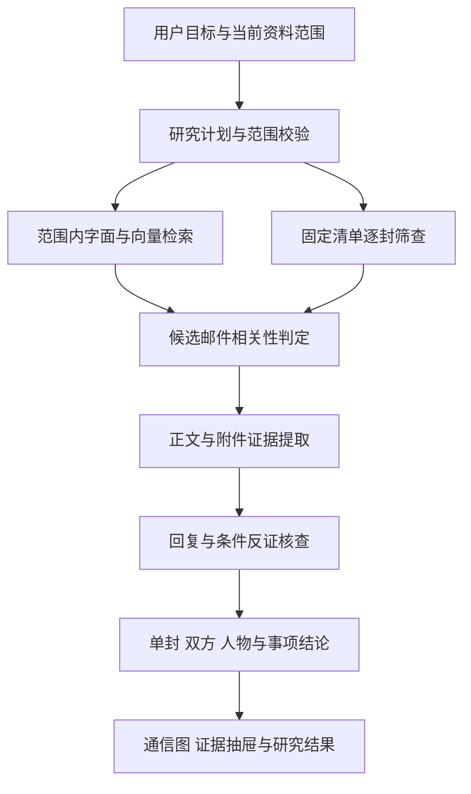

# 邮件研究与通信意图分析改造方案

本次改造在现有邮件拆分、去重、附件处理、会话关系和人物全文分析之上，补齐按用户目标筛选邮件、单封意图、双方意图以及通信图联动。所有结论保留原文位置、表达归属、条件和反证。

## 现有基础与改造原因

| 能力 | 已有实现 | 本次改进 |
| --- | --- | --- |
| 资料基础 | MIME 原件、逻辑邮件、正文片段、附件、回复树和人工多邮箱归并 | 继续复用 |
| 检索 | 字面与 E5 向量融合；筛选范围内仅字面回退 | 在人物、时间和上一结果范围内先过滤再进行向量排名 |
| 研究任务 | lookup、research、exhaustive 关键词分流 | 加入结构化研究计划与明确的相关性判定 |
| 筛选结果 | 检索候选记为 matched；全量清单其余记 unknown | 分批阅读并保存 matched、not_matched、unknown、failed 及依据 |
| 人物分析 | 全部可用正文与附件分批读取、会话反证检查、滚动主题 | 接入双方和单封分析入口，保留完整证据台账 |
| 通信图 | 全局最多 30 节点圆形 SVG，人物为星形图 | 重点关系概览、搜索、缩放、方向箭头、点击人物与双方分析 |

## 执行流程

研究范围同时固定资料包、所有者、时间、人物、角色、附件条件及上一轮结果。正文、引文、转发、签名和附件采用现有归属信息。收到或抄送某封邮件只能证明接收到相关信息；本人表达必须引用本人发出的可归属正文。

## 分析输出

单封分析给出发件方目标、通信动作、请求或条件及待确认事项。双方分析按具体事项展示各方表达、共同点、分歧、计划变化和后续要求。人物分析概括其在当前邮件资料中表达的目标、行动、顾虑和变化，并支持回到逐封原文。

模型产生结构化候选；服务器核对邮箱、邮件范围、引用位置、数值、否定与条件后才保存。意图假设明确标示不确定性。后续修改、取消及附带条件会影响结论状态。摘要是导航，完整发现与反证保存在可分页台账。

## 后台与缓存

新增分析继续使用现有 mail_research 队列、取消检查和跨进程模型调度。每个批次提交检查点后才推进游标，预算用完保留阶段结果，可恢复。缓存以资料实际内容、参与角色、会话关系、范围、问题和分析版本生成指纹；资料变化后需重新分析。

全量筛查逐封处理完整可用文本，只有所有片段都否定且没有正文或附件缺口时，才记为 not_matched。未读、模型失败和预算停止均保留 unknown。语义检索的候选数量与筛查完成数量分别展示。

## 通信图与交互

按用户最终确认的方向，默认显示重点关系，点击人物扩展关联，点击关系查看双方往来与双方意图。后台保留完整关系；图中显示当前展示数量及全部数量，搜索可找到未在初始图中出现的人物。To、Cc、可见 Bcc 分开统计，方向与唯一邮件计数由邮件头确定。

图中的语义说明来自已生成的证据分析。颜色、连线粗细和布局用于帮助阅读，不用于推断真实身份、实际权力或未表达的想法。

## 实施顺序与验收

1. 备份现有源文件、未提交改动及 SQLite 一致性快照，保存哈希清单。
2. 补齐范围内向量检索与结构化研究计划。
3. 落实逐封相关性筛查和可恢复检查点。
4. 增加单封、双方分析服务及证据台账。
5. 完成人物、邮件阅读和通信图的分析入口与联动。
6. 运行现有邮件回归、新增虚构邮件测试、浏览器交互检查和模型实测。

验收至少覆盖：同义表达检索、范围外邮件不泄漏、否定与条件、不把引文归给当前发件方、不把收到当认同、后续撤回改变结论、双方没有回复时不推断同意、长正文完整遍历、取消与恢复、资料版本失效、图节点与边点击原文。模型质量另用虚构多轮谈判样本进行真实模型验证，单元测试通过不等同于真实邮件准确率。

## 恢复

服务器 backups 下保留本次 source.tar.gz、agent.db.gz 和 manifest.json。源码回退只恢复本次修改的邮件文件。本次复用现有数据表，没有新增数据库迁移。恢复整个数据库只在明确需要恢复数据且停止相关写入后执行。

## 已落实的文件与服务边界

| 文件 | 职责 |
| --- | --- |
| services/mail/research/planner.py | 用户目标、相关性标准、多语言查询与显式范围校验 |
| services/mail/research/relevance.py | 分批判定检索候选，避免把检索命中直接当成研究结论 |
| services/mail/semantic.py、research/tools.py | 范围过滤先于向量排名；不可用时明确记录回退 |
| services/mail/analysis_api.py | 单封、双方、逐封筛查的创建、缓存、恢复及所有者隔离 |
| services/mail/analysis.py | 固定清单、完整可用文本读取、会话核查、事项总结、检查点与证据台账 |
| services/mail/jobs.py | 接入现有 mail_research 工作队列，每批完成后续接 |
| static/mail-analysis.js、mail-analysis.css | 研究问题、阅读进度、条件与分歧、原文引用、停止与恢复 |
| static/mail-graph.js | 搜索全部节点、重点概览、方向关系、缩放拖动与双方分析 |
| static/mail-foundation.js、mail-people.js、mail-research.js | 阅读、人物往来和研究结果中的分析入口 |

创建入口为 POST /api/mail/packages/{package_id}/intent-analyses，kind 支持 message、pair、screen。读取与恢复入口分别为 GET /api/mail/intent-analyses/{turn_id}、POST /api/mail/intent-analyses/{turn_id}/resume。身份由服务器解析，请求中传入 owner_id 不会改变访问权限。

分析清单固定 message_keys 与 context_keys，缓存同时覆盖人工确认的邮箱集合。读取、核查、总结分别推进游标。预算按实际调用累计，校验失败后的修正也消耗预算；不会通过重新启动绕过上限。模型原文引用由服务器核验：唯一原文片段的位置由服务器确定，重复片段必须给出明确位置，引用内容和表达归属仍需通过校验。

## 已验证备份及操作边界

备份目录为 /home/nas511/zhoulingjie/sjfx/backups/mail-analysis-20261004-192643。source.tar.gz 保留了改修前的未提交源文件；agent.db.gz 是 SQLite 一致性快照，已通过完整性及压缩 CRC 核验。manifest.json 保存源码与数据库哈希；deployment.json 记录本次替换文件及前后哈希。

源码恢复应按 deployment.json 的清单从 source.tar.gz 取出旧文件，并删除清单中 prior 为 null 的本次新增文件，再重新加载 Web 进程。恢复前先备份恢复时的源文件，避免丢失后续改动。本次没有改动数据表结构，源码回退无需恢复整个数据库。agent.db.gz 只用于明确需要恢复历史数据的场景。

真实邮件的结论质量仍取决于正文与附件覆盖、回复链质量及模型理解。资料缺口与未解条件显示在页面中，用户可以从每条引用打开来源邮件。人物“整体想法”表示其在当前邮件中表达的目标、行动与顾虑，不能视为未表达心理的事实。

## 验证记录

隔离环境中完成接口队列、缓存命中、预算停止与恢复、所有者隔离、范围内向量命中、表达归属、长正文遍历、附件缺口和引用位置校验。当前核心回归为 98 项通过，扩大邮件回归为 293 项通过、11 项子测试通过、9 项因 Node 或指定原始样本缺失而跳过；最后的范围校验调整另经专项复测。

本机 Chromium 使用实际前端脚本、虚构节点和模拟接口完成通信图搜索、关联展开、缩放、人物与边点击、来源邮件、对话框恢复及关闭检查，没有页面脚本异常。已有邮件阅读、人物证据台账和审计模块的浏览器回归也通过。该测试证明交互流程，不代表在所有真实邮件规模下完成性能测试。

服务器本机 vLLM 的 qwen3.6:27b 完成虚构三轮付款谈判的真实调用。正文包含发货前 30% 预付款且需法律批准、对方拒绝并提出货到付款、发件方随后撤回且未达成协议。双方总结保留拒绝与撤回，逐封筛查正确找到三封相关邮件。该样本用于验证流程与条件处理，不能据此给出真实资料准确率。
